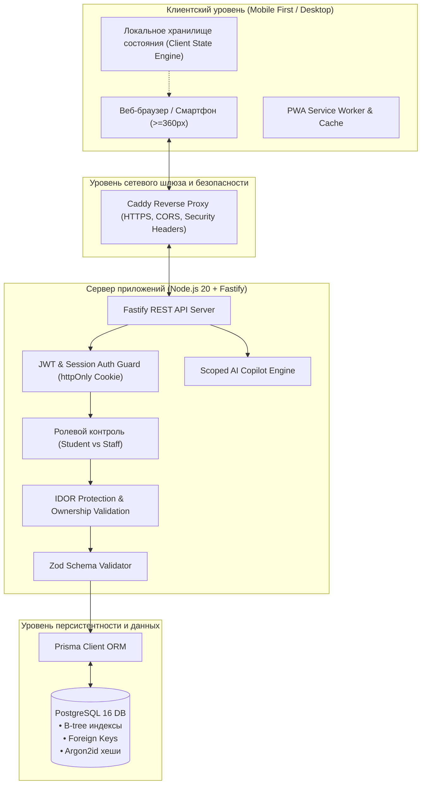

# Архитектура сервиса «Цифровой деканат будущего»
*Конкурсный концепт • DemoTech University • Fictional Data*

## 1. Обзор архитектуры

Система построена по принципу модульного монолита / сервисно-ориентированной архитектуры с четким контрактом взаимодействия (API First на базе OpenAPI 3.0.3).

---

## 2. Ключевые компоненты

### 2.1. Frontend (Клиентская часть)
- **Стек:** React 19, Vite 8, TypeScript, Tailwind CSS v4, Lucide React.
- **Мобильная адаптивность:** Mobile-first архитектура с оптимизацией под экраны от 360px. Нижняя панель навигации (Bottom Bar) для телефонов с сенсорными зонами не менее 44px (WCAG AA). Боковая навигационная панель (Sidebar) для планшетов и десктопов.
- **Автономный демо-режим (Client Fallback Engine):** Фронтенд содержит встроенный движок эмуляции API в строгом соответствии с контрактом `openapi.yaml`. Это гарантирует, что жюри может открыть прототип по ссылке в браузере с любого устройства (в том числе из РФ без VPN) даже при автономном хостинге статики (Vercel, GitHub Pages, Netlify, Yandex Cloud Object Storage).

### 2.2. Backend (Серверная часть)
- **Стек:** Node.js 20+, Fastify v5, TypeScript (strict), Zod, Argon2, JSON Web Tokens.
- **Безопасность:**
  - `@fastify/helmet` — установка защитных заголовков (CSP, HSTS, X-Content-Type-Options).
  - `@fastify/rate-limit` — защита эндпоинта `/auth/login` от перебора паролей (brute-force).
  - `@fastify/cookie` — сессионные куки `dean_session` с флагами `httpOnly`, `Secure` (в prod), `SameSite=Lax`. Никаких токенов в `localStorage`.

### 2.3. База данных (Database)
- **Стек:** PostgreSQL 16 + Prisma ORM.
- **Модели:** `User`, `StudentProfile`, `Faculty`, `Program`, `Group`, `Subject`, `Teacher`, `Room`, `ScheduleEntry`, `Grade`, `RequestType`, `Request`, `RequestStatusHistory`, `Notification`, `Announcement`.
- **Индексы:** по `student_id`, `group_id`, `date`, `status` для обеспечения задержки ответов p95 < 50ms при горизонтальном масштабировании.

---

## 3. Модель безопасности и изоляция данных

1. **Защита от IDOR (Insecure Direct Object References):**
   Каждый запрос к студенческим данным (`/requests`, `/grades`, `/notifications`) извлекает `userId` исключительно из валидированного серверного JWT-токена в куке. Запросы к чужим идентификаторам возвращают `404 Not Found` (а не 403), исключая утечку факта существования чужих записей.
2. **Хеширование паролей:**
   Используется современный алгоритм `Argon2id` (memoryCost: 65536, timeCost: 3, parallelism: 4). Пароли в открытом виде не сохраняются в БД и не выводятся в логи.
3. **Защита от атак по времени (Timing attacks):**
   В роуте аутентификации сравнение хеша выполняется в константное время даже при несуществующем email с помощью фиктивного хеша.
4. **Контекстный AI-ассистент с защитой приватности:**
   Эндпоинт `/assistant/ask` передает языковой модели в системном промпте *только* академический контекст текущего авторизованного студента (его группу, расписание, статус задолженностей). Данные других студентов никогда не попадают в промпт.

---

## 4. Масштабируемость и отказоустойчивость

- **Stateless API:** Сервер приложений Fastify не хранит сессионное состояние в памяти процесса, что позволяет запускать любое количество реплик за балансировщиком (Caddy / Nginx / Traefik).
- **Connection Pooling:** Использование пула соединений Prisma к PostgreSQL с ограничением максимального числа клиентов.
- **PWA-кэширование:** Статические ассеты и иконки кэшируются на клиенте, снижая нагрузку на сеть.
