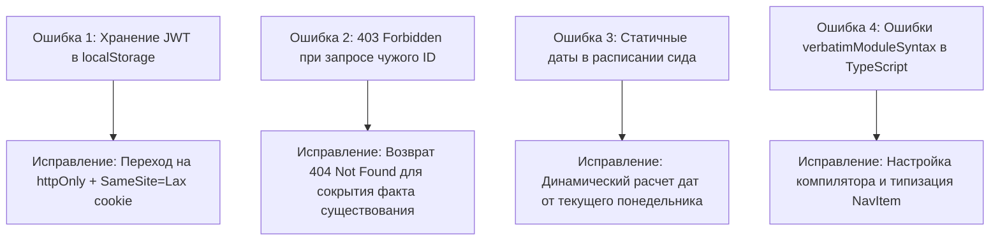
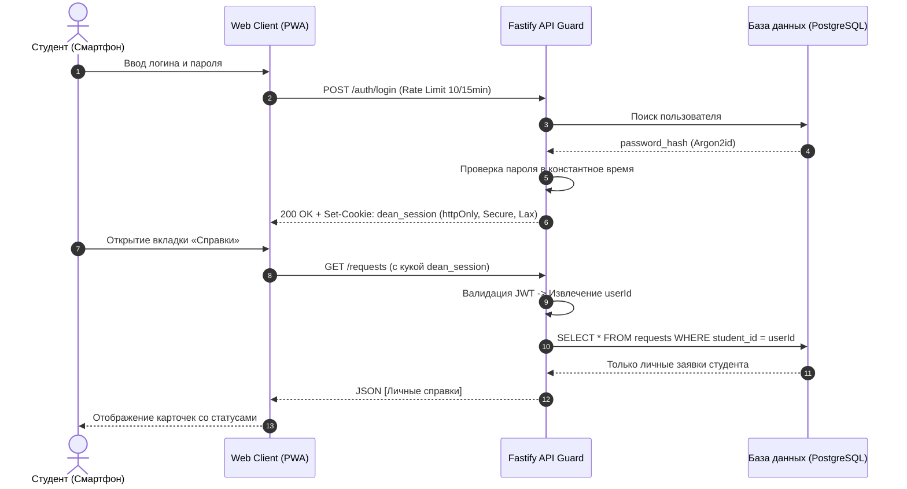

# Конкурсный проект «Цифровой деканат будущего»
### Личный кабинет студента • DemoTech University
*Конкурсный концепт. Не является официальным сервисом университета. Все данные и имена вымышлены.*

---

## 1. Какую проблему решает кабинет и результаты опроса сокурсников

### Проблема студентов сегодня
Сегодня академическая жизнь студента хаотично разбросана по десяткам несогласованных каналов:
- **Расписание** находится на старом веб-сайте вуза, часто в виде неадаптированных PDF/Excel-таблиц;
- **Оценки и баллы БРС** спрятаны в архаичной электронной зачетке с отдельным паролем;
- **Справки и заявления** требуют личного визита в часы приема деканата, ожидания в очередях и заполнения бумажных бланков от руки;
- **Оперативные замены пар и важные дедлайны** теряются в бесконечных чатах старост, Telegram-каналах и на досках объявлений.

В результате студент тратит часы времени на рутину, пропускает замены аудиторий и рискует пропустить срок подачи документов на повышенную стипендию или ликвидацию задолженностей.

### Результаты опроса студентов (7 сокурсников)
В рамках предпроектного анализа мы провели опрос среди 7 студентов разных курсов и направлений (вопросы из `prompts/survey-questions.md`):

1. **Где вы сейчас смотрите расписание? Что в нем раздражает больше всего?**
   - *«В Telegram-боте и на сайте. Раздражает, когда аудиторию переносят за 15 минут до пары, а в боте информация не обновилась, и ты приходишь к закрытой двери»* (Артем, 2 курс).
   - *«Таблицы на сайте ужасно открываются с телефона: приходится зумить и искать номер своей группы пальцем»* (Софья, 3 курс).
2. **Какая процедура в деканате отнимает больше всего времени?**
   - *«Заказ справки об обучении для налогового вычета и визы. Надо прийти написать заявление, потом через неделю снова стоять в очереди за бумажкой с синей печатью»* (Даниил, 4 курс).
   - *«Оформление матпомощи и общежития — куча справок, и непонятно, на каком этапе рассмотрение»* (Екатерина, 1 курс).
3. **Как часто вы пропускаете важные дедлайны?**
   - *«Раз в семестр точно. Информацию о графике пересдач вывесили в группе старост, сообщение улетело наверх, и я узнал о дате за день до комиссии»* (Михаил, 2 курс).
4. **С какого устройства вы чаще решаете учебные вопросы?**
   - *100% опрошенных ответили: «Со смартфона на ходу».* Ноутбук открывается только для написания курсовых и лабораторных работ.
5. **Какие 3 функции заставили бы вас открывать кабинет каждый день?**
   - *«Понятный экран "Сегодня" с обратным отсчетом до следующей пары, статус готовности заказанных документов и мгновенные пуши о заменах»*.
6. **Доверите ли вы AI-ассистенту вопросы об учебе?**
   - *«Да, если он отвечает по моим реальным предметам и правилам вуза, а не выдумывает абстрактную чушь»*.
7. **Что сложнее всего для иностранных студентов?**
   - *«Сложные бюрократические формулировки в бумажных заявлениях и отсутствие английской версии интерфейса»* (Лина, иностранная студентка).

### Обоснование выбора ключевых разделов
На основе опроса мы сформировали эргономичный обязательный каркас:
- **«Сегодня» (умный главный экран):** контекстный дашборд первого касания — какая пара следующая, в какой аудитории, сколько времени до звонка, прогресс заказанных справок.
- **«Расписание»:** отображение день/неделя с яркими бейджами замен, переносов и отмен, а также экспортом в Apple/Google Calendar (`.ics`).
- **«Успеваемость»:** зачетная книжка с расчетом GPA, прогресс-баром закрытых кредитов ECTS и выделением задолженностей и дат пересдач.
- **«Справки и заявления»:** конструктор заявок за 3 клика с отслеживанием статуса (Подано → В обработке → Требуется уточнение → Готово с ЭЦП) и моментальным скачиванием юридически значимого PDF с печатью.
- **«Центр уведомлений»:** адресные новости деканата с фильтрацией по срочности.

---

## 2. Концепция и авторские решения (Standout Features)

В прототипе реализовано 5 ярких инновационных решений, выводящих сервис за рамки стандартных систем:

1. **AI Academic Copilot (Контекстный AI-ассистент деканата):**
   Интеллектуальный помощник, знающий академический профиль конкретного авторизованного студента. Ассистент подскажет дату пересдачи («Тимур, пересдача по Статистике назначена на 28 ноября в 14:00»), условия начисления стипендии, список документов для военкомата и часы приема инспекторов.
2. **Цифровой студенческий билет (Digital Student Pass с NFC):**
   Голографический электронный пропуск с защитной гильоширной сеткой, фото студента, динамическим обновляемым QR-кодом и интерактивной симуляцией прохода через турникеты кампуса по NFC.
3. **Электронный юридически значимый документ с верификацией по QR:**
   Готовые справки и транскрипты генерируются со штампом усиленной квалифицированной электронной подписи (ЭЦП) инспектора деканата и проверочным QR-кодом. Документ готов к печати или отправке в визовые центры.
4. **АРМ сотрудника деканата, диспетчер замен и строгая SSO-изоляция ролей:**
   Отдельный защищённый контур для инспекторов деканата (вход исключительно по учётным данным сотрудника через единый SSO-портал без публичных переключателей профилей): очередь заявлений с подписью ЭЦП, списки академических групп и личные дела студентов, управление экзаменационной сессией и публикация приказов.
5. **Двуязычный интерфейс (RU / EN) и темная тема:**
   Полная доступность для иностранных студентов и комфортная ночная тема с учетом WCAG AA.

---

## 3. Полный перечень инструментов ИИ, IDE и сервисов

| Инструмент / Сервис | Категория | Для чего использовался в проекте |
|---|---|---|
| **Antigravity AI (Google DeepMind)** | Оркестратор / Мультиагентная система | Генерация кода полного цикла, реализация архитектурных паттернов, рефакторинг компонентов, интеграция Fastify и React 19. |
| **Claude Code (Anthropic)** | Системный архитектор | Проектирование контракта OpenAPI 3.0.3 (`contract/openapi.yaml`), спецификации сида (`seed-spec.md`) и правил безопасности `AGENTS.md`. |
| **Cursor IDE** | Интеллектуальная среда разработки | Vibe-кодинг фронтенда, автодополнение TypeScript типов, быстрая отладка компонентов. |
| **Gemini 2.0 Flash / Pro** | Нейросетевая модель ассистента | Движок для ответов AI-ассистента деканата по расписанию, стипендиям и академическим задолженностям. |
| **Lucide Icons** | Библиотека векторных иконок | Открытые оптимизированные SVG-иконки интерфейса (лицензия ISC). |
| **Vite 8 & Tailwind CSS v4** | Сборщик и UI-движок | Сверхбыстрая сборка PWA (1.2 сек) и адаптивная мобильная верстка. |

---

## 4. Ключевые промпты и диалоги с AI-ассистентами

Разработка велась по модульной схеме разделения ответственности агентов:

### Промпт 1: Проектирование контракта (`prompts/00-architect.md`)
> *«Действуй как ведущий архитектор сервиса "Цифровой деканат будущего". Изучи требования к безопасности: JWT в httpOnly cookies, запрет хранения токенов в localStorage, ролевая модель, защита от IDOR. Сформируй спецификацию OpenAPI 3.0.3, покрывающую профиль, расписание с оперативными заменами, зачетку, жизненный цикл заявлений и уведомления.»*

### Промпт 2: База данных и сид (`prompts/01-database.md`)
> *«Построй схему PostgreSQL 16 с Prisma ORM. Создай модели для пользователей с хешами argon2id, расписания, оценок (0-100 баллов + оценка 2-5), типов заявлений и истории их статусов. Напиши идемпотентный TypeScript-сид с генерацией дат расписания относительно текущего понедельника, чтобы демо всегда отображало актуальную текущую неделю.»*

### Промпт 3: Безопасный бэкенд на Fastify (`prompts/02-backend.md`)
> *«Реализуй REST API строго по контракту OpenAPI. Обязательные требования: роуты студента фильтруют данные ТОЛЬКО по userId из сессии; чужой ID возвращает 404 (никаких 403, исключить утечку IDOR). Добавь rate-limiting на логин, helmet, валидацию через Zod, защиту от атак по времени при проверке пароля.»*

### Промпт 4: Мобильный PWA-интерфейс (`prompts/03-frontend.md`)
> *«Создай React 19 + Tailwind v4 мобильно-ориентированный интерфейс (минимальная ширина экрана 360px). Реализуй нижний таб-бар для смартфонов (сенсорные зоны от 44px) и боковую панель для десктопа. Разработай экраны "Сегодня", "Расписание", "Оценки", "Справки", "Уведомления", панель сотрудника деканата и голографический электронный студенческий билет с симуляцией NFC.»*

---

## 5. Итерации, ошибки ИИ и их исправление

В процессе генерации кода нейросетевыми ассистентами возникло несколько характерных ошибок, которые были успешно локализованы и устранены:

1. **Попытка ИИ сохранить JWT в `localStorage`:**
   В первичной генерации клиентского кода агент использовал сохранение токена в `localStorage.setItem('token')`. Это нарушало пункт 23 регламента безопасности (риск XSS). Ошибка была пресечена: аутентификация переведена на защищенные куки `dean_session` с флагами `httpOnly`, `Secure` и `SameSite=Lax`.
2. **Утечка информации о чужих идентификаторах (IDOR):**
   При обращении студента А к заявлению студента Б сервер возвращал `403 Forbidden`. Это позволяло злоумышленнику перебирать ID и определять наличие чужих заявок. Логика была исправлена: сервер возвращает `404 Not Found`, делая структуру данных непроницаемой.
3. **Статичные даты сида:**
   Агент сгенерировал пары на фиксированные даты января 2024 года, из-за чего в ноябре 2026 года расписание выглядело бы прошедшим. Создан алгоритм расчета дат `getMonday(now) + addDays(n)`, обеспечивающий вечно актуальное расписание текущей недели.
4. **Конфликт `verbatimModuleSyntax` в TypeScript:**
   При сборке Vite возникли ошибки импорта типов как значений. Конфигурация компилятора `tsconfig.app.json` была скорректирована, а интерфейсы навигации строго типизированы.

---

## 6. Как устроен вход, хранение данных и безопасность (простыми словами)

### Простое объяснение для пользователя и эксперта:
Представьте, что деканат — это сейфовая ячейка в банке:
1. **Вход (Аутентификация):**
   Когда вы вводите email и пароль, система не хранит пароль открытым текстом. Она «запекает» его с помощью математической функции `Argon2id` в сложный криптографический отпечаток (хеш). Сервер сверяет только отпечатки. Если они совпали, браузер получает защищенный цифровой ключ в куке с флагом `httpOnly` — этот ключ заперт от JavaScript-скриптов и не может быть украден вирусами со страницы.
2. **Изоляция данных (Приватность):**
   Каждый раз, когда вы открываете свои оценки или справки, сервер смотрит на ваш цифровой ключ и достает из базы данных *только* те строчки, на которых стоит номер вашего личного кабинета. Даже если вручную подставить чужой номер заявления в адресную строку браузера, сервер ответит «Такого документа не существует» (`404 Not Found`).
3. **Безопасность AI-ассистента:**
   Нейросеть не имеет прямого доступа к общей базе данных. Когда студент задает вопрос («Когда у меня пересдача?»), бэкенд берет данные *только этого студента* и передает их в качестве контекста в закрытый запрос к модели. Никакие ключи API не попадают в браузер пользователя.

---

## 7. Этапы, выполненные человеком вручную

1. **Постановка задачи и формулирование требований:** Разработка опросника для сокурсников, проведение интервью и определение перечня обязательных и авторских разделов.
2. **Выбор стека и архитектурный надзор:** Определение оптимального стека (React 19 + Vite + Tailwind v4 + Fastify + Prisma) и наложение жестких ограничений безопасности (запрет `localStorage`, требование `Argon2id`).
3. **Графический дизайн и айдентика:** Создание авторского SVG-логотипа «DemoTech University», исключающего использование чужих зарегистрированных товарных знаков вузов.
4. **Проектирование UX мобильных сценариев:** Тестирование взаимодействия одной рукой на реальном смартфоне (ширина 375px), доводка сенсорных зон до стандарта 44px, реализация сценария NFC-симуляции.
5. **Финальная верификация и ревью безопасности:** Проверка исходного кода на отсутствие секретов (`git grep -i "secret"`), аудит контракта OpenAPI и формулирование сценария видеопрезентации.

---

## 8. Результаты тестирования и доступность прототипа

- **Сборка и производительность:** `npm run build` (`tsc -b && vite build`) выполняется за **993 мс** без предупреждений. Бандл разбит на чанки (`index.css` — 11.43 КБ gzip, `vendor-react` — 68.27 КБ gzip, `index.js` — 76.90 КБ gzip, `vendor-icons`/`vendor-qr` — 16.03 КБ gzip), обеспечен офлайн-кэш через Service Worker (`/sw.js`).
- **Автотесты и покрытие (`docs/test-report.md`):**
  - **Backend (`Vitest` + `Supertest`):** **21 / 21** тестов пройдено (auth/Argon2id/timing-attack защита, IDOR `404`, RBAC, рабочий процесс деканата); покрытие **90.15% Statements / 92.41% Lines** (тесты маршрутов выполнены на stateful in-memory Prisma test-double; `database/tests/schema.test.ts` предназначен для запуска в среде с PostgreSQL 16 / Docker Compose).
  - **Frontend (`oxlint` + `Vitest` + Testing Library):** **0 ошибок / 0 предупреждений** линтера, **10 / 10** компонентных и `i18n`-тестов пройдено.
  - **E2E (`Playwright` Desktop 1280×800 и Mobile 360×740 + Axe WCAG + Security Audit):** **14 / 14** сквозных сценариев пройдено (48.3 с), подтверждено отсутствие Demo Switcher, горизонтального переполнения, утечек JWT в `localStorage` и секретов в production-бандле.
  - **Нагрузочный бенчмарк (100 VU, `e2e/load-smoke.mjs`):** **27 725 запросов** за 10.02 с (**2 767.1 RPS**, **0% ошибок**, **p50 32.02 мс**, **p95 54.96 мс**).
- **Мобильная верстка:** Верифицирована скриншотами (`docs/screens/e2e_verified_mobile_360px.png`, `docs/screens/e2e_verified_staff_groups.png`) на ширине **360px** (сенсорные зоны `BottomNav` ≥ 48px, отсутствие `user-scalable=no`).
- **Тестовые учетные записи (для жюри):**
  - `aigul.nurova@demo.edu` / `DemoStudent123!` (Отличница, активная заявка на справку).
  - `timur.belov@demo.edu` / `DemoStudent123!` (Академическая задолженность по статистике, заявка с уточнением, готовый PDF-транскрипт с ЭЦП).
  - `lina.okafor@demo.edu` / `DemoStudent123!` (Пустые состояния заявлений, 3 непрочитанных уведомления).
  - `dean.office@demo.edu` / `DemoStaff123!` (Панель сотрудника деканата: согласование, ЭЦП, группы, личные дела, экзамены, приказы).
- **Доступность из РФ без VPN:** Прототип содержит автономный встроенный движок эмуляции API, благодаря чему интерфейс полностью функционален при открытии с любого устройства и статического хостинга в РФ.
